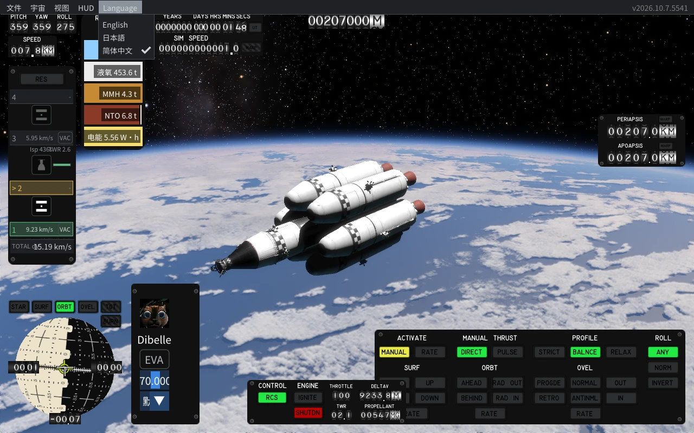

# KSA UI Languages

   

[English](README.md) · **简体中文** · [日本語](README.ja.md)

**Kitten Space Agency 的多语言界面模组：用简体中文或日文游玩，并可随时在游戏内切换语言。**

Kitten Space Agency 是一款以真实物理为基础的硬核航天模拟游戏：你亲手设计火箭，按真实的轨道力学飞行。上手不难，但对喜欢挑战的玩家来说几乎没有上限。

*飞行界面，显示简体中文 UI。Language 菜单可在 English、日本語、简体中文之间切换。*

## 亮点

- **一键切换语言**：在游戏内菜单选择 English、日本語 或 简体中文，选择会被记住。
- **离线安装，简单省事**：一个安装包搞定，无需管理员权限，也不用另外下载。
- **存档安全**：更新时保留设置和存档，配置会自动备份。
- **认真翻译**：每种语言 1,625 条词条，逐条按含义校对；RCS、Δv 等玩家熟悉的写法保持不变。
- **每次发布前**都在每个支持的游戏版本上做过测试。

## 下载与安装

**最新版本：v0.9.0 预览版**，支持 Windows x64 和 KSA 2026.10.7.5541 / 2026.10.10.5554。[下载 v0.9.0](https://github.com/LiX-Works/KsaUiLanguages/releases/tag/v0.9.0)，推荐选择 **KsaUiLanguages-0.9.0-installer6-win-x64.zip**。

1. 先安装上述对应版本的 KSA，确认原版能正常运行。
2. 完整解压安装包，关闭游戏，双击 **Install.cmd**，选择包含 **KSA.dll** 的游戏目录。
3. 从桌面 **“KSA UI Languages (5554)”** 或 **“KSA UI Languages (5541)”** 启动，名称取决于所选游戏版本。
4. 游戏内通过 **Language → English / 日本語 / 简体中文** 切换语言，选择会保留到下次启动。

安装器提示为英文，确认许可时选择 **Yes**。请运行 Install.cmd；双击 Install.ps1 可能只会打开记事本。

**更新**：运行新的安装包，选择原来的游戏目录。设置、存档和启动语言都会保留；配置和旧插件会备份，存档不会自动备份。每个游戏版本（5541 或 5554）使用独立的实例，游戏本体不会被改动。[详细安装、更新与卸载说明](docs/INSTALLER.md)

各版本的变化见 [更新记录（CHANGELOG）](CHANGELOG.md)。

## 语言

- **三种语言**：简体中文和日文，以及原版英文。翻译覆盖设置、飞船编辑器、常用飞行窗口和 HUD、规划、轨迹和存档窗口；尚未翻译的内容保持英文。
- **保留熟悉的标识**：RCS、EVA、Isp、TWR、HUD、Δv 等缩写，以及单位、快捷键、部件型号和你给飞船起的名字，都保持原样。

## 已知限制

- 部分界面和标签仍是英文。
- 较长的文字和存档名可能显示不全。
- 日文目前与中文共用字体，部分汉字会显示为中文字形。
- 尚未测试所有游戏操作和长时间游玩。[详细发布说明](docs/RELEASE_NOTES_v0.9.0.md)

## 工作原理

模组在游戏运行时替换屏幕上的文字，不修改游戏文件，所以游戏目录保持原样。构建和测试细节见 [开发与构建](docs/DEVELOPMENT.md)。

## 反馈、参与与许可

发现译文有误或不通顺？欢迎 [提交 issue](https://github.com/LiX-Works/KsaUiLanguages/issues)。参与翻译请看 [贡献翻译](CONTRIBUTING.md)；参考资料：[校对字典](docs/DICTIONARY.md) · [部件命名核查](docs/PART_NAMING_REVIEW.md) · [版本编号规则](docs/VERSIONING.md)。

这是非官方社区模组，**不含 KSA 游戏本体或 Starship 飞船模组**。独立代码和译文采用 **MIT**，字体采用 **SIL OFL**；加载器和运行时适用随附许可。[许可证与来源](THIRD_PARTY.md)
